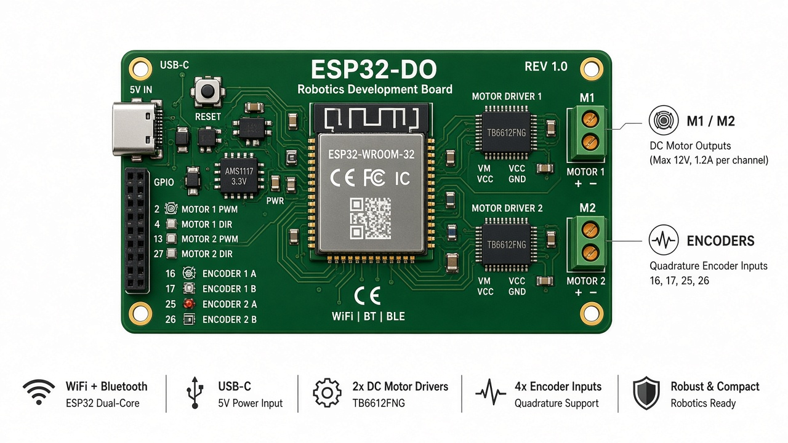
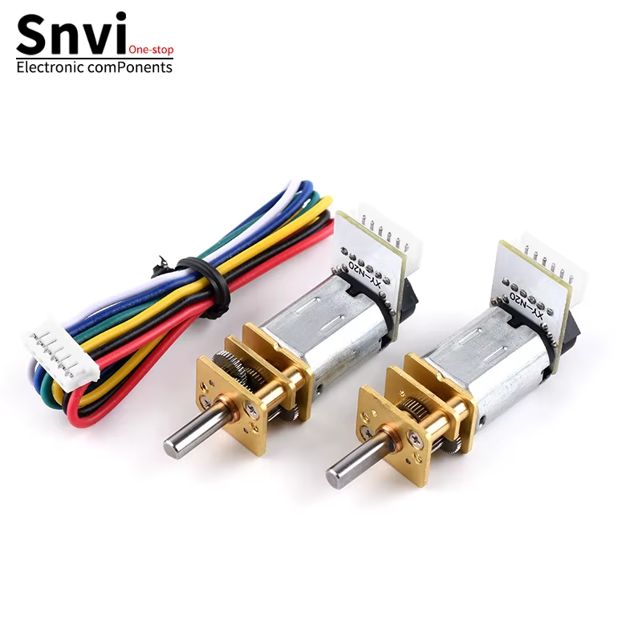
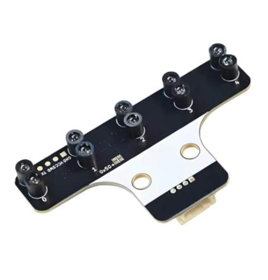
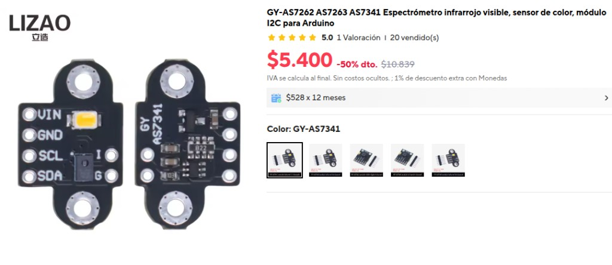
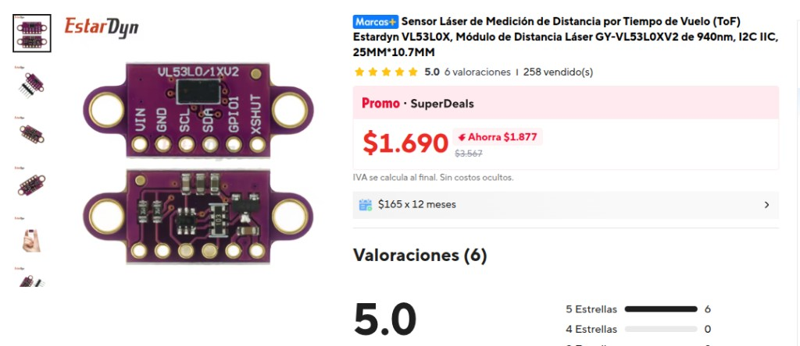
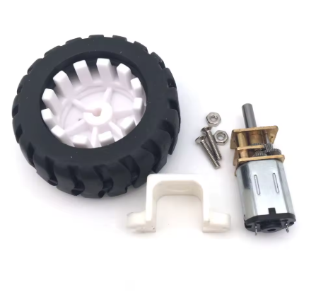
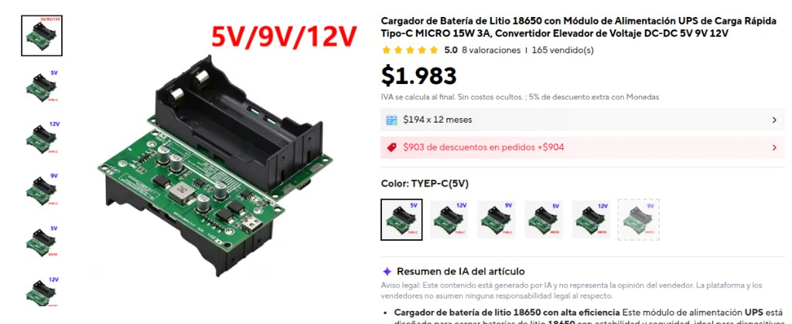
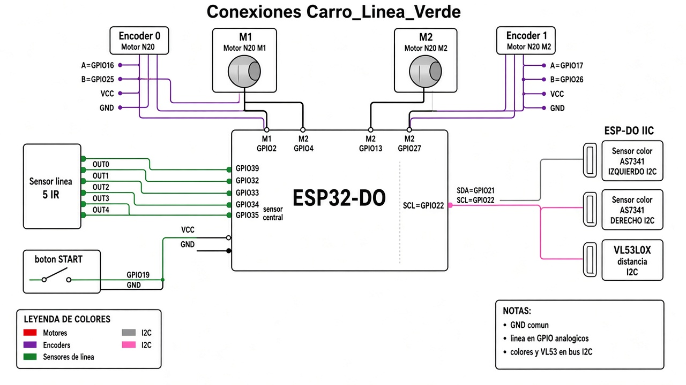

# Rescate ESP32 — Robots de línea / Rescue Line

Repositorio con **dos robots** independientes para competencia tipo rescate / seguidor de línea.

## Proyectos

| Carpeta | Descripción |
|---------|-------------|
| **`Rescate_ESP32`** | Carro complejo: línea, 3× VL53L0X, GY-91, laberinto, telemetría ESP-NOW |
| **`Monitor_Rescate`** | Monitor táctil 240×320 (ajuste en vivo + modo prueba) |
| **`Monitor_Rescate_800`** | Monitor 800×480 |
| **`Carro_Linea_Verde`** | Segundo carro (simplificado): N20+encoder, verdes en intersecciones, obstáculo 10 cm |

---

## Placa ESP32-DO

Controlador con **driver de motores integrado**. Pines de motor: M1 = GPIO 2/4, M2 = GPIO 13/27. Encoders: 16/25 y 17/26. I2C: SDA=21, SCL=22.

*Placa ESP-DO: conectores M1/M2, GPIO, ADC, IIC y SPI.*

---

## Componentes del carro sigue líneas

Componentes reales del segundo carro (`Carro_Linea_Verde`).

### Motores N20 con encoder (XY-N20)

Dos motores N20 con placa encoder (cuadratura A/B) y cable de 6 hilos.

### Sensor de línea 5 IR (I2C, dir. 0x50)

Barra de cinco canales infrarrojos con conector JST (GND, VCC, SCL, SDA).

### Sensores de color GY-AS7341 (×2)

Espectrómetro / sensor de color por I2C (VIN, GND, SCL, SDA) para detectar cuadros verdes a izquierda y derecha de la línea.

### Sensor de distancia VL53L0X

Láser ToF frontal para el obstáculo de ~10 cm (VIN, GND, SCL, SDA, GPIO1, XSHUT).

### Rueda, soporte y fijaciones N20

Rueda con neumático, soporte plástico para N20 y tornillería.

### Módulo de alimentación 18650 (UPS + boost)

Cargador / UPS con salida 5 V / 9 V / 12 V (15 W) para alimentar la placa y los motores.

### Listado resumen

| Cant. | Componente |
|------:|------------|
| 1 | ESP32-DO |
| 2 | Motor N20 + encoder XY-N20 |
| 2 | Rueda + soporte N20 |
| 1 | Sensor de línea 5 IR (I2C 0x50) |
| 2 | GY-AS7341 (color) |
| 1 | VL53L0X |
| 1 | Módulo UPS 18650 (5 V recomendado) |

Detalle de pines: [`Carro_Linea_Verde/README.md`](Carro_Linea_Verde/README.md) y `config.h` de cada proyecto.

---

## Conexiones

Esquema de cableado de referencia sobre ESP32-DO (motores, encoders, línea, colores y obstáculo).

> Confirme siempre los pines en `config.h`. El sensor de línea y los AS7341 usan **I2C** (puede requerir mux o segundo bus si hay conflicto de direcciones).

---

## Uso

Abrir el `.ino` correspondiente en Arduino IDE, seleccionar placa **ESP32**, ajustar pines en `config.h` si hace falta, y subir.
