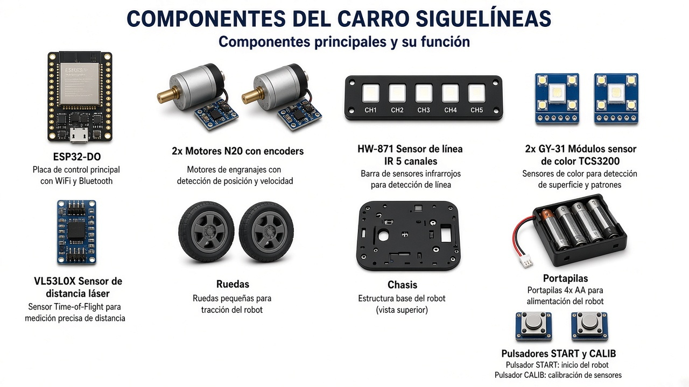

# Rescate ESP32 — Robots de línea / Rescue Line

Repositorio con **dos robots** independientes para competencia tipo rescate / seguidor de línea.

## Proyectos

| Carpeta | Descripción |
|---------|-------------|
| **`Rescate_ESP32`** | Carro complejo: HW-871, 3× VL53L0X, GY-91, laberinto, telemetría ESP-NOW |
| **`Monitor_Rescate`** | Monitor táctil 240×320 (ajuste en vivo + modo prueba) |
| **`Monitor_Rescate_800`** | Monitor 800×480 |
| **`Carro_Linea_Verde`** | Segundo carro (simplificado): N20+encoder, verdes en intersecciones, obstáculo 10 cm |

---

## Placa ESP32-DO

Controlador con **driver de motores integrado**. Pines de motor oficiales: M1 = GPIO 2/4, M2 = GPIO 13/27. Encoders: 16/25 y 17/26.

---

## Componentes del carro

Vista general de los módulos usados (ESP32-DO, motores N20 con encoder, barra HW-871, sensores de color, VL53L0X, ruedas y pulsadores).

Detalle y listado completo: ver [`Carro_Linea_Verde/README.md`](Carro_Linea_Verde/README.md) y [`Rescate_ESP32/config.h`](Rescate_ESP32/config.h).

---

## Conexiones

Esquema de cableado de referencia para el segundo carro (`Carro_Linea_Verde`) sobre ESP32-DO: motores, encoders, línea, colores y obstáculo frontal.

> Las imágenes son ilustrativas. Confirme siempre los pines en `config.h` de cada proyecto.

---

## Hardware principal

- Placa **ESP32-DO** (driver de motores integrado: M1=2/4, M2=13/27; encoders 16/25 y 17/26)
- Barra de línea 5 IR (HW-871)
- Sensores según cada proyecto (ver `config.h` / `README.md` de cada carpeta)

## Uso

Abrir el `.ino` correspondiente en Arduino IDE, seleccionar placa **ESP32**, ajustar pines en `config.h` si hace falta, y subir.
